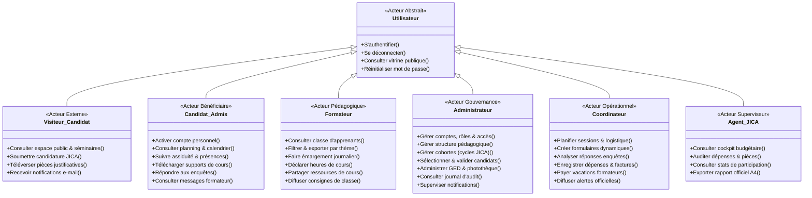
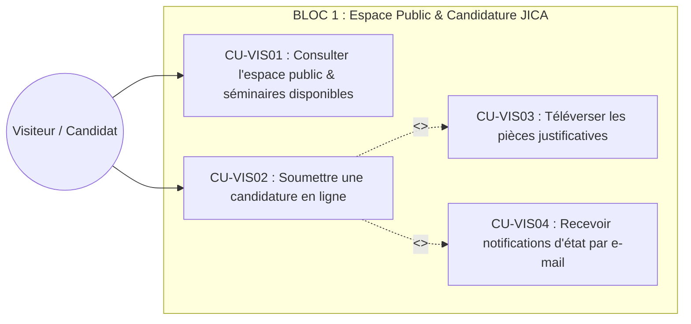
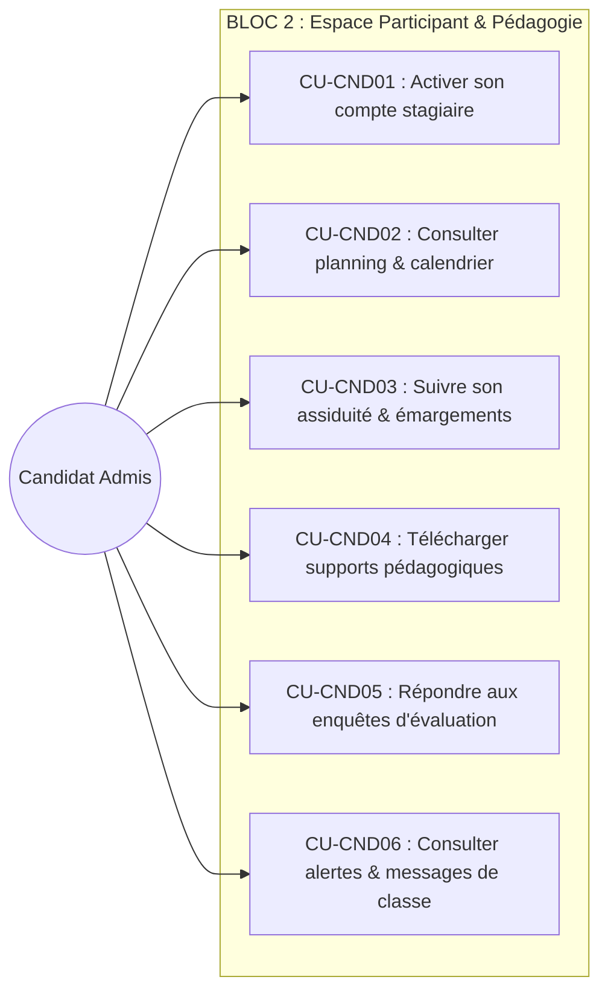
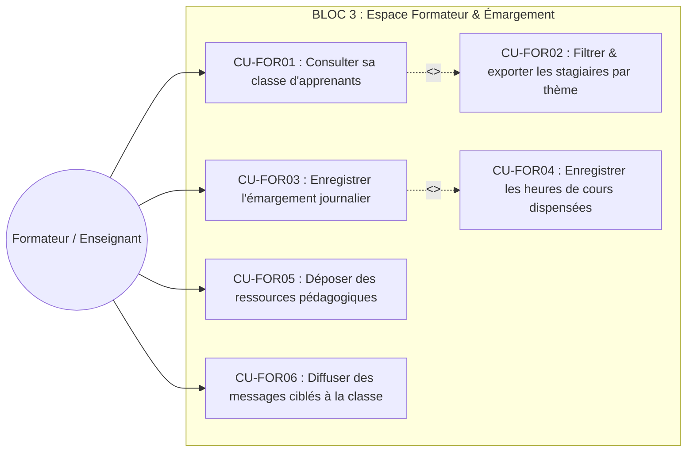
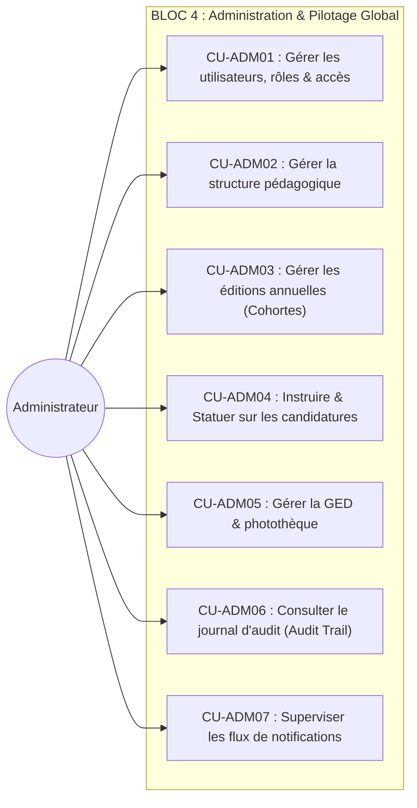
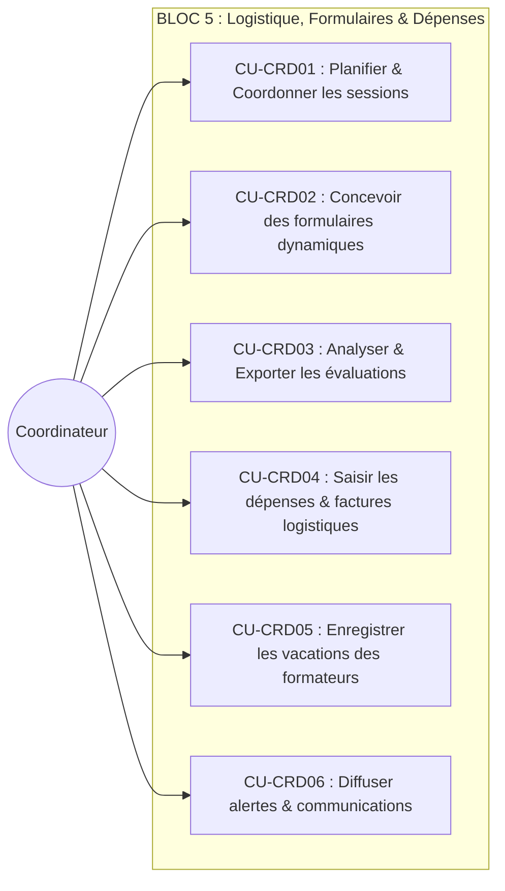
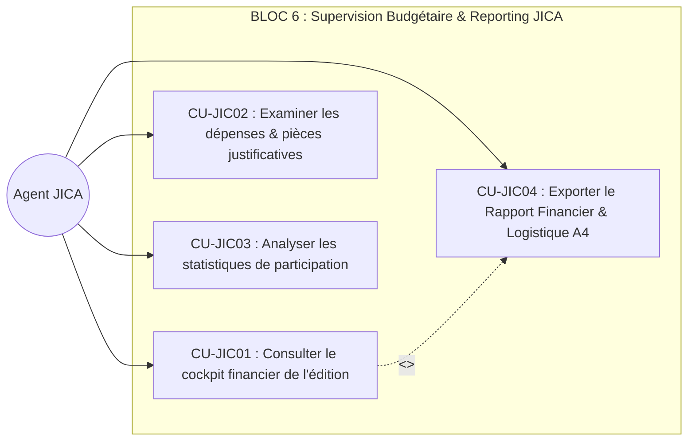
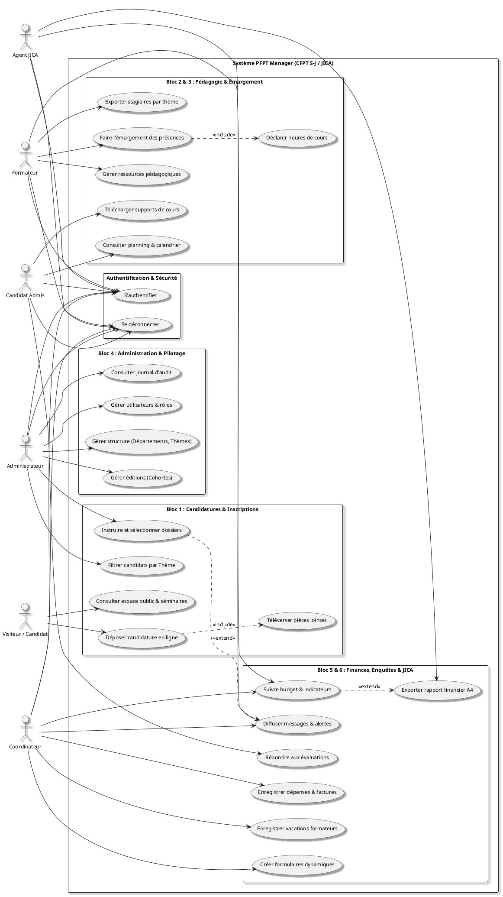

# 🏛️ DIAGRAMMES DE CAS D'UTILISATION (UML) & SPÉCIFICATION FONCTIONNELLE DÉTAILLÉE PAR ACTEUR

> **Projet** : Plateforme de Gestion de la Formation Professionnelle et Technique (PFPT • CFPT Sénégal-Japon & JICA)  
> **Type de document** : Modélisation conceptuelle & Spécification des Cas d'Utilisation pour **Mémoire de Fin d'Études / Rapport de Projet**  
> **Organisation** : 6 Blocs d'Acteurs Opérationnels + 1 Bloc Transversal (33 Cas d'Utilisation au total)  
> **Conformité** : Alignement strict avec le **Diagramme de Classes**, le **Dictionnaire des Données** et le code applicatif Laravel.

---

## 🧭 1. TABLEAU RÉCAPITULATIF DES CAS D'UTILISATION PAR ACTEUR

| # | Bloc Acteur | Identifiant | Cas d'Utilisation | Module Associé | Objectif Opérationnel |
|:---:|---|:---:|---|---|---|
| **1** | **Visiteur / Candidat** | `CU-VIS01` | Consulter l'espace public & les séminaires disponibles | M3 : Pédagogie | Découvrir l'offre de formation continue et les conditions d'éligibilité. |
| **2** | **Visiteur / Candidat** | `CU-VIS02` | Soumettre une candidature en ligne | M4 : Candidatures | Saisir le formulaire officiel JICA en 3 étapes. |
| **3** | **Visiteur / Candidat** | `CU-VIS03` | Téléverser les pièces justificatives | M4 : Candidatures | Joindre CV, diplômes, passeport et certificat médical. |
| **4** | **Visiteur / Candidat** | `CU-VIS04` | Recevoir les notifications d'état par e-mail | M9 : Communication | Être informé par e-mail (accusé de réception, sélection, mise en attente). |
| **5** | **Candidat Admis** | `CU-CND01` | Activer son compte stagiaire | M1 : Authentification | Définir son mot de passe via le jeton d'invitation sécurisé. |
| **6** | **Candidat Admis** | `CU-CND02` | Consulter son calendrier & planning | M6 : Suivi Pédagogique | Visualiser l'emploi du temps, horaires et salles de cours. |
| **7** | **Candidat Admis** | `CU-CND03` | Suivre son assiduité & émargements | M6 : Suivi Pédagogique | Contrôler ses présences, absences et volume horaire suivi. |
| **8** | **Candidat Admis** | `CU-CND04` | Télécharger les supports pédagogiques | M6 : GED | Accéder aux polycopiés, diaporamas et guides partagés. |
| **9** | **Candidat Admis** | `CU-CND05` | Répondre aux formulaires d'évaluation | M8 : Enquêtes | Compléter les évaluations de fin de module (à chaud / à froid). |
| **10** | **Candidat Admis** | `CU-CND06` | Consulter les alertes & messages de classe | M9 : Communication | Recevoir les consignes et annonces émises par le formateur. |
| **11** | **Formateur** | `CU-FOR01` | Consulter sa classe d'apprenants | M5 : Formateurs | Visualiser la liste nominative des stagiaires affectés. |
| **12** | **Formateur** | `CU-FOR02` | Filtrer & Exporter les stagiaires par thème | M5 : Formateurs | Télécharger la liste filtrée par spécialité technique. |
| **13** | **Formateur** | `CU-FOR03` | Enregistrer l'émargement journalier | M6 : Émargement | Cocher les présences/absences pour chaque séance de cours. |
| **14** | **Formateur** | `CU-FOR04` | Enregistrer les heures de cours dispensées | M5 : Formateurs | Déclarer le volume horaire effectué par séance (4h/séance). |
| **15** | **Formateur** | `CU-FOR05` | Déposer des ressources pédagogiques | M6 : GED | Mettre à disposition des documents réservés à sa cohorte. |
| **16** | **Formateur** | `CU-FOR06` | Diffuser des messages ciblés à la classe | M9 : Communication | Envoyer un message/email collectif ou par sous-groupe. |
| **17** | **Administrateur** | `CU-ADM01` | Gérer les utilisateurs, rôles & accès (RBAC) | M1 : Sécurité | Créer, modifier, suspendre des comptes et attribuer les rôles. |
| **18** | **Administrateur** | `CU-ADM02` | Gérer la structure pédagogique | M3 : Structure | Administrer les départements, séminaires et thématiques. |
| **19** | **Administrateur** | `CU-ADM03` | Gérer les éditions annuelles (Cohortes) | M2 : Éditions | Créer un cycle, allouer le budget, archiver ou réactiver. |
| **20** | **Administrateur** | `CU-ADM04` | Instruire & Statuer sur les candidatures | M4 : Candidatures | Valider (admis), rejeter ou placer sur liste d'attente. |
| **21** | **Administrateur** | `CU-ADM05` | Gérer la photothèque & documents officiels | M6 : GED | Administrer les attestations, règlements et archives globales. |
| **22** | **Administrateur** | `CU-ADM06` | Consulter le journal d'audit (Audit Trail) | M10 : Traçabilité | Suivre l'historique complet et horodaté des actions système. |
| **23** | **Administrateur** | `CU-ADM07` | Superviser les notifications système | M9 : Communication | Contrôler la délivrance des alertes et emails automatiques. |
| **24** | **Coordinateur** | `CU-CRD01` | Planifier & Coordonner les sessions | M3 : Pédagogie | Organiser le calendrier logistique et l'accueil des délégations. |
| **25** | **Coordinateur** | `CU-CRD02` | Concevoir des formulaires dynamiques | M8 : Enquêtes | Créer des enquêtes sur mesure avec champs modulables. |
| **26** | **Coordinateur** | `CU-CRD03` | Analyser & Exporter les évaluations | M8 : Enquêtes | Exploiter les données de satisfaction et générer des synthèses. |
| **27** | **Coordinateur** | `CU-CRD04` | Saisir les dépenses & factures logistiques | M7 : Finances | Enregistrer les frais d'hébergement, restauration, transport. |
| **28** | **Coordinateur** | `CU-CRD05` | Enregistrer les vacations des formateurs | M7 : Finances | Comptabiliser les honoraires dus selon le barème JICA. |
| **29** | **Coordinateur** | `CU-CRD06` | Diffuser des alertes & communications | M9 : Communication | Émettre des notes de service aux participants et intervenants. |
| **30** | **Agent JICA** | `CU-JIC01` | Consulter le tableau de bord financier | M7 : Finances | Visualiser le taux d'exécution budgétaire en temps réel. |
| **31** | **Agent JICA** | `CU-JIC02` | Examiner les dépenses & pièces justificatives | M7 : Finances | Consulter le journal analytique des dépenses et factures. |
| **32** | **Agent JICA** | `CU-JIC03` | Analyser les statistiques de participation | M4 : Statistiques | Observer la représentativité par pays, genre et profil. |
| **33** | **Agent JICA** | `CU-JIC04` | Exporter le Rapport Financier & Logistique (PDF A4) | M7 : Reporting | Télécharger le rapport officiel JICA avec titre personnalisable. |
| **34** | **Tous Utilisateurs** | `CU-GEN01` | S'authentifier / Se déconnecter | M1 : Accès | Accéder de manière sécurisée aux interfaces selon son profil. |

---

## 👥 2. HIÉRARCHIE DES ACTEURS DU SYSTÈME



---

## 📦 3. BLOCS DE CAS D'UTILISATION PAR ACTEUR

```
===================================================================================
                               SYSTÈME PFPT MANAGER
===================================================================================
 ┌───────────────────────────────────────────────────────────────────────────────┐
 │ BLOC 1 : VISITEUR & CANDIDAT EXTERNE (Espace Public & Candidature JICA)       │
 ├───────────────────────────────────────────────────────────────────────────────┤
 │ BLOC 2 : CANDIDAT ADMIS / STAGIAIRE (Portail Participant & Pédagogie)         │
 ├───────────────────────────────────────────────────────────────────────────────┤
 │ BLOC 3 : FORMATEUR / ENSEIGNANT (Portail Formateur, Émargement & Heures)      │
 ├───────────────────────────────────────────────────────────────────────────────┤
 │ BLOC 4 : ADMINISTRATEUR SYSTÈME (Administration, Structure & Sélections)      │
 ├───────────────────────────────────────────────────────────────────────────────┤
 │ BLOC 5 : COORDINATEUR DU PROGRAMME (Logistique, Formulaires & Dépenses)       │
 ├───────────────────────────────────────────────────────────────────────────────┤
 │ BLOC 6 : AGENT JICA (Supervision Budgétaire & Reporting Officiel)             │
 └───────────────────────────────────────────────────────────────────────────────┘
```

---

### 🟢 BLOC 1 : ACTEUR VISITEUR / CANDIDAT EXTERNE

Ce bloc regroupe l'ensemble des interactions ouvertes au public et aux candidats postulant depuis les pays partenaires d'Afrique francophone.



#### Fiches Descriptives des Cas d'Utilisation - Bloc 1

##### `CU-VIS01` : Consulter l'espace public & les séminaires disponibles
* **Acteur principal** : Visiteur / Candidat externe.
* **Préconditions** : Aucune (accès libre sans authentification).
* **Description** : Le visiteur consulte la vitrine publique du PFPT, découvre les séminaires de formation ouverts, les dates limites de soumission, les prérequis techniques et les pays cibles.

##### `CU-VIS02` : Soumettre une candidature en ligne
* **Acteur principal** : Visiteur / Candidat externe.
* **Acteur secondaire** : Système d'information, Administrateur (destinataire de notification).
* **Préconditions** : Le séminaire doit être publié (`status = active`) et la période de candidature ouverte.
* **Déclencheur** : Le candidat clique sur *« Postuler à ce séminaire »* depuis le portail public.
* **Scénario nominal** :
  1. Le candidat saisit ses informations d'identité (nom, prénom, genre, nationalité, pays de provenance).
  2. Le candidat renseigne son profil professionnel (ministère ou organisme de tutelle, établissement de formation, fonction, spécialité technique).
  3. Le candidat renseigne son état de santé et ses contraintes alimentaires/logistiques (norme JICA).
  4. Le système valide la conformité des données et déclenche obligatoirement l'étape `CU-VIS03 : Téléverser les pièces justificatives`.
  5. Le candidat valide et soumet définitivement son dossier.
  6. Le système enregistre la candidature avec le statut `pending` (En cours d'examen).
  7. Le système déclenche automatiquement l'envoi d'un e-mail d'accusé de réception (`CU-VIS04`) et notifie les administrateurs.
* **Scénarios alternatifs** :
  * *Email déjà existant pour la même cohorte* : Le système informe le candidat qu'une candidature est déjà enregistrée.
  * *Champs obligatoires manquants* : Le système surligne les champs erronés et bloque la soumission.
* **Postconditions** : Une entrée `Registration` et `CandidateProfile` est créée ; le candidat attend la décision du comité par e-mail.

##### `CU-VIS03` : Téléverser les pièces justificatives
* **Relation** : `<<include>>` depuis `CU-VIS02`.
* **Description** : Le candidat téléverse ses justificatifs obligatoires (CV actualisé, copie du passeport/CNI, diplôme technique le plus élevé, certificat médical). Les fichiers sont vérifiés (PDF/JPG, max 5 Mo) et stockés de façon sécurisée.

##### `CU-VIS04` : Recevoir les notifications d'état par e-mail
* **Relation** : `<<extend>>` depuis `CU-VIS02`.
* **Description** : Le candidat ne dispose pas d'un tableau de bord de suivi à ce stade : l'ensemble des retours (accusé de dépôt, notification de sélection avec lien d'activation, placement sur liste d'attente ou notification de rejet) lui sont directement transmis par notification e-mail automatique.

---

### 🔵 BLOC 2 : ACTEUR CANDIDAT ADMIS / PARTICIPANT

Ce bloc concerne les candidats retenus par la commission de sélection, qui disposent d'un compte utilisateur dédié.



#### Fiches Descriptives des Cas d'Utilisation - Bloc 2

##### `CU-CND01` : Activer son compte stagiaire
* **Acteur principal** : Candidat admis.
* **Préconditions** : La candidature a été validée par l'administrateur (`status = approved`) et un email d'activation contenant un jeton sécurisé a été envoyé.
* **Scénario nominal** :
  1. Le candidat clique sur le lien d'activation reçu par email.
  2. Le système vérifie la validité du jeton cryptographique.
  3. Le candidat définit son mot de passe personnalisé respectant la politique de sécurité (8 caractères min).
  4. Le système active le compte `User` associé et connecte automatiquement le participant à son espace.
* **Postconditions** : Le participant accède à son tableau de bord, son planning et ses documents de cours.

##### `CU-CND03` : Suivre son assiduité & émargements
* **Acteur principal** : Candidat admis.
* **Description** : Le participant consulte en temps réel son relevé de présence cours par cours, son total d'heures effectuées et son taux d'assiduité global calculé par le système.

##### `CU-CND05` : Répondre aux enquêtes d'évaluation
* **Acteur principal** : Candidat admis.
* **Description** : Le participant accède aux formulaires d'évaluation à chaud/froid mis en ligne par le coordinateur pour évaluer les modules, les formateurs et les conditions logistiques.

---

### 🟠 BLOC 3 : ACTEUR FORMATEUR / ENSEIGNANT

Ce bloc structure les outils mis à disposition des formateurs et experts pour conduire les enseignements et assurer le suivi pédagogique.



#### Fiches Descriptives des Cas d'Utilisation - Bloc 3

##### `CU-FOR03` : Enregistrer l'émargement journalier
* **Acteur principal** : Formateur.
* **Acteur secondaire** : Administrateurs (destinataires de notification).
* **Préconditions** : Le formateur est authentifié et affecté au séminaire actif (`seminar_trainer`).
* **Scénario nominal** :
  1. Le formateur sélectionne le séminaire et la date de la séance.
  2. Le système affiche la grille nominative des apprenants de la cohorte.
  3. Pour chaque apprenant, le formateur valide l'état : *Présent*, *Absent*, ou *Absent Justifié*.
  4. Le formateur valide la saisie.
  5. Le système enregistre les émargements (`attendances`) et déclenche `CU-FOR04` pour comptabiliser les 4 heures de cours de la session.
  6. Le système notifie les administrateurs de la validation de la feuille de présence.
* **Postconditions** : Les statistiques d'assiduité des apprenants et le volume horaire du formateur sont mis à jour immédiatement.

##### `CU-FOR06` : Diffuser des messages ciblés à la classe
* **Acteur principal** : Formateur.
* **Description** : Le formateur rédige une communication officielle, sélectionne le public cible (tous les stagiaires de son séminaire ou un sous-groupe thématique), et joint éventuellement un fichier. Le message est diffusé dans les boîtes de réception in-app et expédié par email aux stagiaires et aux coordinateurs.

---

### 🔴 BLOC 4 : ACTEUR ADMINISTRATEUR SYSTÈME

Ce bloc couvre la gouvernance complète de la plateforme, la sécurité, les référentiels et la sélection des candidats.



#### Fiches Descriptives des Cas d'Utilisation - Bloc 4

##### `CU-ADM03` : Gérer les éditions annuelles (Cohortes)
* **Acteur principal** : Administrateur.
* **Description** : L'administrateur configure les cycles PFPT annuels (titre, dates de début et de fin, budget total alloué en FCFA, thèmes couverts). Il peut basculer une édition en cours (`active`), clôturer et archiver une édition passée (`completed`), ou réactiver une édition archivée.

##### `CU-ADM04` : Instruire & Statuer sur les candidatures
* **Acteur principal** : Administrateur.
* **Scénario nominal** :
  1. L'administrateur accède au registre des candidatures reçues avec filtres par pays, genre et séminaire.
  2. Il consulte le dossier complet (profil JICA, parcours, pièces justificatives téléversées).
  3. Il attribue une décision : *Sélectionné (approved)*, *Liste d'attente (waiting_list)*, ou *Rejeté (rejected)*.
  4. En cas d'approbation, le système génère un compte utilisateur et déclenche l'envoi de l'invitation d'activation.
  5. L'action est inscrite dans le journal d'audit (`activity_logs`).

---

### 🟣 BLOC 5 : ACTEUR COORDINATEUR DU PROGRAMME

Ce bloc réunit les fonctions opérationnelles de coordination des formations, des évaluations et des dépenses logistiques sur le terrain.



#### Fiches Descriptives des Cas d'Utilisation - Bloc 5

##### `CU-CRD02` : Concevoir des formulaires dynamiques
* **Acteur principal** : Coordinateur.
* **Description** : Le coordinateur crée des questionnaires d'évaluation modulables sans modification de code. Il définit le titre, le public cible (candidats ou formateurs), le séminaire associé, et ajoute des champs variés (texte, notation sur 5, choix unique, choix multiple).

##### `CU-CRD04` : Saisir les dépenses & factures logistiques
* **Acteur principal** : Coordinateur.
* **Description** : Le coordinateur enregistre chaque dépense opérationnelle (hébergement, restauration, pauses-café, fournitures, transport) en l'imputant à l'édition concernée et à la catégorie analytique JICA, avec le montant en FCFA, la date et la pièce justificative numérisée.

---

### 🟡 BLOC 6 : ACTEUR AGENT / REPRÉSENTANT JICA

Ce bloc est dédié aux représentants de l'agence de coopération japonaise pour la supervision financière, le contrôle de conformité et le reporting de haut niveau.



#### Fiches Descriptives des Cas d'Utilisation - Bloc 6

##### `CU-JIC01` : Consulter le cockpit financier de l'édition
* **Acteur principal** : Agent JICA.
* **Description** : L'agent JICA accède en lecture sécurisée au tableau de bord financier présentant le budget global alloué, le montant total des dépenses exécutées, le montant des honoraires formateurs versés, et le solde budgétaire restant en FCFA avec graphiques de répartition.

##### `CU-JIC04` : Exporter le Rapport Financier & Logistique (PDF A4)
* **Acteur principal** : Agent JICA, Administrateur.
* **Description** : L'agent déclenche la génération du rapport officiel format A4 portrait. Le document intègre le titre choisi, la synthèse financière, le tableau des rémunérations formateurs, l'état détaillé des dépenses logistiques et la liste des participants certifiés.

---

## 🌐 4. DIAGRAMME GLOBAL INTÉGRÉ DU SYSTÈME (MERMAID)

```mermaid
flowchart TB
    %% Acteurs
    Visiteur((Visiteur / Candidat))
    Candidat((Candidat Admis))
    Formateur((Formateur))
    Admin((Administrateur))
    Coordinateur((Coordinateur))
    JICA((Agent JICA))

    %% Frontières du système
    subgraph PFPT_System["PLATEFORME PFPT MANAGER (CFPT Sénégal-Japon & JICA)"]
        direction TB

        subgraph Securite["Sécurité & Authentification"]
            UC_Auth["S'authentifier"]
            UC_Logout["Se déconnecter"]
        end

        subgraph Mod_Candidature["Module Candidatures & Admissions"]
            UC_ConsulterSem["Consulter espace public & séminaires"]
            UC_Postuler["Déposer candidature JICA"]
            UC_Pieces["Téléverser pièces jointes"]
            UC_Select["Instruire & Valider dossiers"]
            UC_Filter["Filtrer candidats par thème"]
        end

        subgraph Mod_Pedagogie["Module Pédagogie & Émargement"]
            UC_Planning["Consulter planning & calendrier"]
            UC_Presence["Faire l'émargement des séances"]
            UC_Heures["Déclarer les heures dispensées"]
            UC_GED["Gérer / Télécharger ressources"]
        end

        subgraph Mod_Finance["Module Finances & Budgets JICA"]
            UC_Budget["Suivre cockpit budgétaire"]
            UC_Depenses["Saisir dépenses & factures"]
            UC_Honoraires["Payer honoraires formateurs"]
            UC_ExportPDF["Exporter rapport financier A4"]
        end

        subgraph Mod_Evaluation["Module Formulaires & Évaluations"]
            UC_CreateForm["Créer formulaires dynamiques"]
            UC_AnswerForm["Répondre aux évaluations"]
            UC_StatsForm["Analyser résultats enquêtes"]
        end

        subgraph Mod_Admin["Module Administration & Traçabilité"]
            UC_Users["Gérer utilisateurs & rôles"]
            UC_Cohortes["Gérer éditions & cycles"]
            UC_Audit["Consulter journal d'audit"]
            UC_Messages["Diffuser alertes & messages"]
        end
    end

    %% Relations Acteurs -> Cas d'Utilisation
    Visiteur --> UC_ConsulterSem
    Visiteur --> UC_Postuler
    UC_Postuler -.->|<<include>>| UC_Pieces

    Candidat --> UC_Auth
    Candidat --> UC_Planning
    Candidat --> UC_GED
    Candidat --> UC_AnswerForm
    Candidat --> UC_Logout

    Formateur --> UC_Auth
    Formateur --> UC_Presence
    Formateur --> UC_GED
    Formateur --> UC_Filter
    Formateur --> UC_Messages
    Formateur --> UC_Logout

    UC_Presence -.->|<<include>>| UC_Heures

    Admin --> UC_Auth
    Admin --> UC_Users
    Admin --> UC_Cohortes
    Admin --> UC_Select
    Admin --> UC_Audit
    Admin --> UC_Logout

    Coordinateur --> UC_Auth
    Coordinateur --> UC_Budget
    Coordinateur --> UC_Depenses
    Coordinateur --> UC_Honoraires
    Coordinateur --> UC_CreateForm
    Coordinateur --> UC_Messages
    Coordinateur --> UC_Logout

    JICA --> UC_Auth
    JICA --> UC_Budget
    JICA --> UC_ExportPDF
    JICA --> UC_Logout

    UC_Budget -.->|<<extend>>| UC_ExportPDF
    UC_CreateForm -.->|<<extend>>| UC_StatsForm
```



---

## 💻 5. CODE PLANTUML COMPLET POUR EXPORT STARUML / WORD


