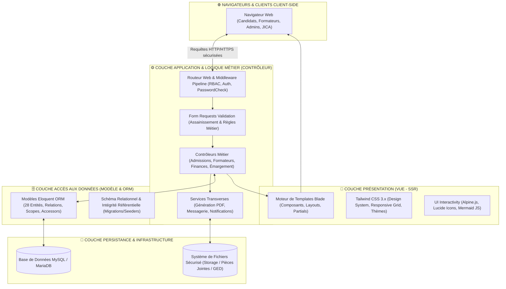

# 🏛️ II.2.7 ARCHITECTURE CONCEPTUELLE DU SYSTÈME PFPT MANAGER

> **Extrait officiel pour le Mémoire de Fin d'Études / Rapport de Projet**  
> **Section** : *Chapitre II : Conception & Modélisation — Sous-section II.2.7 Architecture Conceptuelle*  
> **Système** : Plateforme de Gestion de la Formation Professionnelle et Technique (PFPT • CFPT Sénégal-Japon & JICA)

---

## 📑 II.2.7 Architecture Conceptuelle Globale

L'architecture logicielle retenue pour le système **PFPT Manager** s'appuie sur le paradigme architectural **MVC (Modèle-Vue-Contrôleur)**, enrichi d'une approche en **couches logicielles étanches (Layered Architecture)** et de services transverses. Ce choix garantit le respect strict du principe de **Séparation des Préoccupations** (*Separation of Concerns - SoC*), assurant une forte cohésion au sein de chaque couche, un faible couplage inter-modules, ainsi qu'une maintenabilité, une évolutivité et une robustesse maximales.



---

### 1. Couche Présentation (Vue - User Interface)

La couche de présentation est responsable de l'affichage des informations, de l'interaction avec l'utilisateur et de la restitution dynamique des données envoyées par les contrôleurs.

* **Moteur de Templates Blade** :
  * **Rendu côté serveur (SSR - *Server-Side Rendering*)** : Contrairement aux architectures SPA complexes, le rendu côté serveur offre une sécurité accrue (le code source applicatif et les clés de logique ne sont jamais exposés au client), une vitesse d'exécution instantanée sans temps de compilation côté navigateur, et une compatibilité optimale avec tous types de terminaux.
  * **Composabilité & Héritage de Gabarits** : L'interface est structurée autour de gabarits maîtres hiérarchisés (`layouts/admin.blade.php`, `layouts/portal.blade.php`, `layouts/public.blade.php`) avec injection dynamique de sections (`@yield`, `@section`) et de composants réutilisables (`<x-badge>`, `<x-table>`, `<x-card>`).
  * **Directives de Sécurité Intégrées** : Utilisation systématique des directives contextuelles Blade telles que `@csrf` (protection contre les failles CSRF), `@auth` / `@guest` (contrôle d'affichage selon la session), et `@if(auth()->user()->hasRole(...))` pour adapter dynamiquement les interfaces aux privilèges de l'utilisateur.

* **Framework CSS Tailwind CSS** :
  * Intégration d'un système de design utilitaire garantissant une cohérence visuelle sur l'ensemble des 10 modules fonctionnels.
  * Conception adaptative (*Mobile-First Responsive Design*) adaptée aux postes administratifs haute résolution, aux tablettes des formateurs pour l'émargement en atelier, et aux smartphones des candidats.
  * Respect de la charte graphique institutionnelle du **CFPT Sénégal-Japon** et de la **JICA** (contrastes accessibles, typographie professionnelle, jauges financières interactives).

* **Interactivité Légère & Visualisation Client** :
  * Intégration d'**Alpine.js** et de scripts légers pour la gestion des modales, filtres instantanés et menus déroulants sans surcharger la bande passante.
  * Rendu vectoriel via **Mermaid.js** et **Lucide Icons** pour l'affichage interactif des organigrammes et des diagrammes de formation.

---

### 2. Couche Logique Métier & Traitement (Contrôleur & Services)

Cette couche constitue le cœur applicatif de la plateforme ; elle orchestre les flux d'informations, applique les règles de gestion et garantit l'intégrité des processus.

* **Routage Déclaratif & Pipeline de Middlewares** :
  * Centralisation des points d'entrée dans `routes/web.php`, partitionnés en groupes sémantiques isolés (`/admin`, `/portal/candidate`, `/portal/trainer`, `/auth`).
  * **Pipeline de filtrage de sécurité (Middlewares)** :
    * `Authenticate` : Verrouille l'accès aux seules sessions légitimes.
    * `RoleMiddleware` : Vérifie l'adéquation entre le rôle de l'utilisateur (`role_id`) et la route sollicitée (RBAC - *Role-Based Access Control*).
    * `CheckPasswordChanged` : Intercepte les nouveaux utilisateurs créés par l'administration et impose le renouvellement de leur mot de passe temporaire dès la première connexion (`must_change_password == 1`).
    * `EnsureEmailIsVerified` : Vérifie la validation préalable de l'adresse courriel pour les postulants.

* **Contrôleurs Métier Dédiés (Controllers)** :
  * Découpage strict selon le standard *Resource Controllers* (`CandidateProfileController`, `RegistrationController`, `AttendanceController`, `ExpenseController`, `SeminarController`).
  * Application du principe **"Skinny Controllers, Fat Models & Services"** : les contrôleurs se limitent à recevoir la requête validée, à invoquer les modèles/services appropriés, et à retourner la vue ou la redirection correspondante avec messages flash d'état (`session()->flash('success')`).

* **Validation Formelle des Flux (Form Requests Validation)** :
  * Déportation systématique des règles de validation dans des classes dédiées héritant de `FormRequest` (`StoreRegistrationRequest`, `UpdateProfileRequest`, `StoreExpenseRequest`).
  * Assainissement des données, typage strict, rejet automatique des requêtes non conformes avant même l'exécution du code métier, et renvoi transparent des erreurs contextuelles vers le formulaire Blade.

* **Services Métier Transverses** :
  * Module d'exportation documentaire et de facturation (génération de reçus PDF, listes d'émargement et rapports financiers au format tableur/PDF).
  * Système de notifications multi-canaux (alertes in-app dans la cloche de notification et courriels transactionnels de notification).

---

### 3. Couche d'Accès aux Données & Persistance (Modèle & ORM Eloquent)

La couche de données encapsule la structure informationnelle du progiciel et gère les échanges avec la base de données relationnelle MySQL.

* **ORM Eloquent (Object-Relational Mapping)** :
  * Implémentation du patron de conception **Active Record** : chaque table du dictionnaire des données est représentée par une classe de modèle PHP dédiée (28 modèles pour les 28 tables).
  * **Typage & Casts Natifs** : Conversion automatique des attributs complexes (`answers_json`, `health_questionnaire_json`, `target_roles`, `selected_topics` convertis nativement en tableaux PHP / JSON, `session_date` en objets `Carbon DateTime`).
  * **Scopes Locaux & Global Scopes** : Méthodes d'encapsulation de requêtes récurrentes (ex. `scopeActive()`, `scopeApproved()`, `scopeForCohort()`) garantissant l'homogénéité des filtres SQL dans l'ensemble de l'application.

* **Modélisation Déclarative des Relations Inter-Objets** :
  * Définition explicite des cardinalités : `hasOne` (Profil Candidat, Facture), `belongsTo` (Rôle, Séminaire, Cohorte), `hasMany` (Inscriptions, Émargements, Dépenses), et `belongsToMany` avec tables pivots enrichies (`department_seminar`, `seminar_trainer`, `message_user`).
  * Optimisation par chargement lié systématique (**Eager Loading** via `with(['user', 'seminar'])`) pour éradiquer le problème d'amplification de requêtes ($N+1$ query problem).

* **Intégrité Référentielle & Gestion de Schéma (Migrations & Seeders)** :
  * Structuration intégrale de la base de données par des fichiers de migration versionnés sous Git.
  * Définition explicite des contraintes d'intégrité au niveau du moteur de stockage InnoDB : clés primaires auto-incrémentées (`id`), clés étrangères avec cascades contrôlées (`onDelete('cascade')` ou `nullOnDelete()`), index d'unicité sur les courriels (`email`), les slugs et les jetons de partage (`share_token`).

---

### 4. Couche Transverse : Sécurité & Gouvernance des Données

La sécurité constitue une dimension fondamentale intégrée transversalement à toutes les couches de l'architecture logicielle :

```
┌────────────────────────────────────────────────────────────────────────┐
│               SÉCURITÉ & GOUVERNANCE APPLICATIVE                       │
├────────────────────────────────────────────────────────────────────────┤
│  🔐 AUTHENTIFICATION  : Bcrypt, Multi-Auth (Classique + Google OAuth2) │
│  🛡️ CONTRÔLE D'ACCÈS   : RBAC Middleware (Admin, Coord, Formateur, ...) │
│  🚫 INJECTIONS SQL    : Requêtes Préparées PDO (Zéro concaténation)   │
│  🔒 PROTECTION CSRF   : Jetons cryptographiques aléatoires par session │
│  🧼 PROTECTION XSS    : Échappement HTML automatique dans Blade        │
│  ⏱️ RATE LIMITING     : Blocage du brute-force sur /login (Throttling) │
│  📜 AUDIT TRAIL       : Journalisation inaltérable dans activity_logs  │
└────────────────────────────────────────────────────────────────────────┘
```

1. **Chiffrement & Gestion des Mots de Passe** : Hachage unidirectionnel des mots de passe à l'aide de l'algorithme **Bcrypt** avec coût adaptatif, empêchant toute compromission des identifiants même en cas d'accès direct à la base de données.
2. **Protection contre les Injections SQL** : L'ORM Eloquent utilise systématiquement le mécanisme des requêtes préparées (*Parameter Binding*) via l'extension PHP Data Objects (PDO), neutralisant totalement les tentatives d'injection SQL.
3. **Protection contre le Cross-Site Request Forgery (CSRF)** : Chaque requête mutatrice (`POST`, `PUT`, `PATCH`, `DELETE`) est conditionnée à la fourniture d'un jeton cryptographique généré aléatoirement et vérifié par le middleware `VerifyCsrfToken`.
4. **Protection contre le Cross-Site Scripting (XSS)** : Le moteur Blade échappe automatiquement tout contenu injecté via les balises `{{ }}`, convertissant les caractères réservés HTML en entités inoffensives.
5. **Protection contre les Attaques par Force Brute (Rate Limiting)** : Les contrôleurs d'authentification appliquent une limitation stricte des tentatives de connexion (`throttle:6,1`), bloquant temporairement les adresses IP suspectes.
6. **Journalisation & Traçabilité (Audit Trail)** : La table `activity_logs` enregistre automatiquement l'auteur (`user_id`), la nature de l'action, l'adresse IP et l'identifiant du modèle affecté pour chaque événement sensible (validation d'inscription, décaissement financier, modification de rôle).

---

### 5. Synthèse des Bénéfices Techniques de l'Architecture

| Critère d'Évaluation | Solution Apportée par l'Architecture PFPT Manager |
|---|---|
| **Maintenabilité** | Découpage en 10 modules indépendants et étanches ; modification d'un module sans régression sur les autres. |
| **Sécurité des données** | Neutralisation native des failles du Top 10 OWASP (CSRF, XSS, Injections SQL, Brute force). |
| **Performance & Réactivité** | Rendu SSR ultra-rapide, requêtes Eloquent optimisées par *Eager Loading*, indexation fine des clés en base de données. |
| **Auditabilité & Conformité** | Traçabilité complète des transactions financières et des admissions pour les audits conjoints CFPT / JICA. |
| **Extensibilité future** | Capacité d'adjoindre de nouveaux modules pédagogiques ou d'exposer une API REST sans refondre la base de données. |
