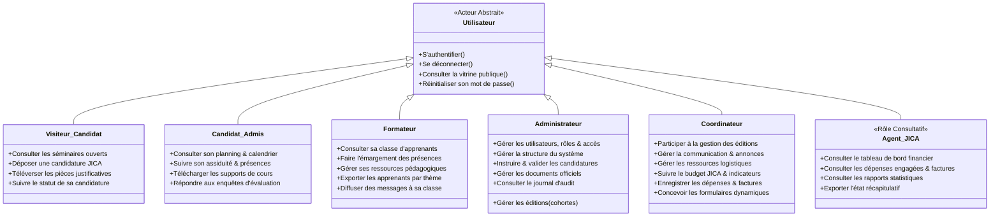

# 📊 DIAGRAMMES DE CAS D'UTILISATION (UML) - PROJET PFPT MANAGER (CFPT S-J & JICA)

> **Projet** : Plateforme de Formation Professionnelle & Technique (PFPT • CFPT / JICA)  
> **Modélisation** : Diagramme de Cas d'Utilisation UML (Use Case Diagram)  
> **Emplacement dans le Mémoire (`memoire_text.txt`)** : Chapitre II, Section `II.2.3 Diagramme de cas d'utilisation` (Pages 12 à 16, *Figure 4*)

---

## 👥 1. HIÉRARCHIE & DÉFINITION DES 6 ACTEURS DU SYSTÈME

Le système PFPT Manager distingue **6 profils d'acteurs opérationnels** avec des responsabilités précises :

---

## 🧭 2. MATRICE ACTEURS $\times$ CAS D'UTILISATION (6 ACTEURS)

| Cas d'Utilisation | Visiteur / Candidat | Candidat Admis | Formateur | Administrateur | Coordinateur | Agent JICA |
|---|:---:|:---:|:---:|:---:|:---:|:---:|
| **S'authentifier (CU01)** | — | **✓** | **✓** | **✓** | **✓** | **✓** |
| **Se déconnecter (CU02)** | — | **✓** | **✓** | **✓** | **✓** | **✓** |
| **Déposer une candidature JICA (CU13)** | **✓** | — | — | — | — | — |
| **Téléverser pièces justificatives (CU15)** | **✓** | — | — | — | — | — |
| **Suivre l'état du dossier** | **✓** | — | — | — | — | — |
| **Consulter planning & présences (CU25)**| — | **✓** | — | — | **✓\*** | — |
| **Télécharger supports de cours (CU27)** | — | **✓** | **✓** | **✓** | **✓** | — |
| **Gérer ses ressources pédagogiques (CU26)** | — | — | **✓** | **✓** | **✓\*** | — |
| **Faire l'émargement des séances (CU24)**| — | — | **✓** | — | **✓\*** | — |
| **Exporter stagiaires par thème (CU23)** | — | — | **✓** | **✓** | **✓** | — |
| **Gérer les utilisateurs & rôles** | — | — | — | **✓** | — | — |
| **Gérer la structure du système (CU09/10/11)**| — | — | — | **✓** | — | — |
| **Gérer les éditions / cohortes (CU05/06)**| — | — | — | **✓** | **✓\*** | — |
| **Instruire & Valider dossiers (CU16/17)**| — | — | — | **✓** | **✓\*** | — |
| **Gérer les documents système** | — | — | — | **✓** | **✓\*** | — |
| **Gérer la communication / messages (CU37)**| — | — | **✓\*** | — | **✓** | — |
| **Gérer les formulaires dynamiques (CU33)** | — | — | — | — | **✓** | — |
| **Répondre aux évaluations en ligne (CU35)**| — | **✓** | **✓** | — | — | — |
| **Suivre le budget & indicateurs (CU28)** | — | — | — | **✓\*** | **✓** | **✓** |
| **Enregistrer dépenses & factures (CU29)**| — | — | — | — | **✓** | — |
| **Consulter dépenses & factures** | — | — | — | **✓** | **✓** | **✓** |
| **Consulter rapports statistiques** | — | — | — | **✓** | **✓** | **✓** |
| **Consulter journal d'audit (CU41)** | — | — | — | **✓** | — | — |

*\* Droits délégués ou partagés selon le modèle d'autorisation et la charte de gestion.*

---

## 🔗 3. RELATIONS SPÉCIFIQUES (INCLUSIONS & EXTENSIONS)

1. **Relations d'Inclusion (`<<include>>`)** :
   - *Authentification* : Les cas d'utilisation nécessitant un accès authentifié incluent le cas `« S'authentifier »`. La déconnexion constitue un cas d'utilisation indépendant.
   - *Dépôt de candidature* : `Déposer candidature en ligne` $\xrightarrow{<<include>>}$ `Téléverser pièces justificatives`.

2. **Relations d'Extension (`<<extend>>`)** :
   - *Notifications* : Le cas `« Recevoir une notification »` peut étendre certains cas d'utilisation lorsqu'une action génère une alerte, notamment lors de la validation d'une candidature, de la modification du planning ou de l'ajout d'un document.
   - *Exports* : L'export des données (PDF, CSV ou Excel) peut étendre certaines fonctionnalités de consultation, d'analyse ou de suivi lorsque l'utilisateur souhaite générer un document exploitable (*export des stagiaires par thème*, *export des dépenses pour la JICA*, *export des résultats d'enquêtes*).
   - *Journalisation* : Le cas `« Journaliser l'activité »` étend les opérations sensibles nécessitant une traçabilité dans le système (*enregistrement d'une dépense*, *validation d'une candidature*, *modification d'une édition*).

---

## 💻 4. CODE PLANTUML HARMONISÉ (POUR STARUML & MÉMOIRE)

```plantuml
@startuml
left to right direction
skinparam packageStyle rectangle
skinparam handwritten false
skinparam monochrome false
skinparam shadowing true
skinparam defaultFontName Arial
skinparam defaultFontSize 12

actor "Visiteur / Candidat" as Visiteur
actor "Candidat Admis" as Candidat
actor "Formateur" as Formateur
actor "Administrateur" as Admin
actor "Coordinateur" as Coordinateur
actor "Agent JICA" as JICA

rectangle "Système PFPT Manager (CFPT S-J / JICA)" {
  
  package "Authentification & Sécurité" {
    usecase "S'authentifier" as UC_Auth
    usecase "Se déconnecter" as UC_Logout
  }

  package "Administration & Structure Système" {
    usecase "Gérer les utilisateurs & rôles" as UC_Users
    usecase "Gérer la structure du système\n(Départements, Séminaires, Thèmes)" as UC_Struct
    usecase "Gérer les éditions (Cohortes)" as UC_Editions
    usecase "Consulter le journal d'audit" as UC_Audit
  }

  package "Candidatures & Admissions" {
    usecase "Déposer candidature en ligne" as UC_Postuler
    usecase "Téléverser pièces jointes" as UC_Pieces
    usecase "Instruire et sélectionner dossiers" as UC_Select
    usecase "Filtrer candidats par Thème" as UC_FilterTopic
  }

  package "Pédagogie & Émargement" {
    usecase "Faire l'émargement des présences" as UC_Presence
    usecase "Consulter planning & absences" as UC_ConsultPresence
    usecase "Gérer ses ressources pédagogiques" as UC_GED_Trainer
    usecase "Télécharger supports de cours" as UC_GED_Candidate
    usecase "Exporter stagiaires par thème" as UC_ExportTheme
  }

  package "Logistique, Finances & Budgets JICA" {
    usecase "Suivre le budget & indicateurs" as UC_Budget
    usecase "Enregistrer dépenses & vacations" as UC_Depenses
    usecase "Consulter dépenses & factures" as UC_ConsultDep
    usecase "Exporter bilan financier JICA" as UC_ExportFin
  }

  package "Formulaires & Communication" {
    usecase "Gérer les formulaires dynamiques" as UC_Forms
    usecase "Répondre aux évaluations" as UC_RepondreForm
    usecase "Diffuser messages ciblés" as UC_Messages
    usecase "Recevoir notifications d'alertes" as UC_Notif
    usecase "Journaliser l'activité" as UC_LogAction
  }
}

' --- Relations Visiteur ---
Visiteur --> UC_Postuler
UC_Postuler ..> UC_Pieces : <<include>>

' --- Relations Candidat Admis ---
Candidat --> UC_Auth
Candidat --> UC_ConsultPresence
Candidat --> UC_GED_Candidate
Candidat --> UC_RepondreForm
Candidat --> UC_Logout

' --- Relations Formateur ---
Formateur --> UC_Auth
Formateur --> UC_Presence
Formateur --> UC_GED_Trainer
Formateur --> UC_ExportTheme
Formateur --> UC_Messages
Formateur --> UC_Logout

' --- Relations Administrateur ---
Admin --> UC_Auth
Admin --> UC_Users
Admin --> UC_Struct
Admin --> UC_Editions
Admin --> UC_Select
Admin --> UC_FilterTopic
Admin --> UC_Audit
Admin --> UC_Logout

' --- Relations Coordinateur ---
Coordinateur --> UC_Auth
Coordinateur --> UC_Budget
Coordinateur --> UC_Depenses
Coordinateur --> UC_Forms
Coordinateur --> UC_Messages
Coordinateur --> UC_ExportTheme
Coordinateur --> UC_Logout

' --- Relations Agent JICA (Consultatif) ---
JICA --> UC_Auth
JICA --> UC_Budget
JICA --> UC_ConsultDep
JICA --> UC_Logout

' --- Inclusions (Authentification obligatoire pour cas sécurisés) ---
UC_Select ..> UC_Auth : <<include>>
UC_Presence ..> UC_Auth : <<include>>
UC_Budget ..> UC_Auth : <<include>>
UC_Depenses ..> UC_Auth : <<include>>
UC_Users ..> UC_Auth : <<include>>
UC_Audit ..> UC_Auth : <<include>>

' --- Extensions ---
UC_Budget ..> UC_ExportFin : <<extend>>
UC_Select ..> UC_Notif : <<extend>>
UC_Depenses ..> UC_LogAction : <<extend>>

@enduml
```

