# 🏛️ DIAGRAMME DE CLASSES UML & NOTICE DESCRIPTIVE ACADÉMIQUE

> **Projet** : Plateforme de Gestion de la Formation Professionnelle et Technique (PFPT • CFPT Sénégal-Japon & JICA)  
> **Type de document** : Modélisation conceptuelle & Spécification technique pour **Mémoire de Fin d'Études / Rapport de Projet**  
> **Organisation** : 28 Classes réparties sur 10 Modules Métier  
> **Conformité** : Alignement strict avec le **Dictionnaire des Données** et l'architecture logicielle Laravel.

---

## 🧭 1. TABLEAU DES 28 CLASSES PAR MODULES MÉTIER

| # | Module Fonctionnel | Classe UML | Table Technique | Rôle Métier |
|:---:|---|---|---|---|
| **1** | **M1 : Authentification & Accès** | `User` | `users` | Comptes utilisateurs, authentification, identités et rôles. |
| **2** | **M1 : Authentification & Accès** | `Role` | `roles` | Définition des profils et privilèges d'accès (RBAC). |
| **3** | **M1 : Authentification & Accès** | `PasswordResetToken` | `password_reset_tokens` | Jetons cryptographiques de réinitialisation de mot de passe. |
| **4** | **M2 : Éditions & Cohortes** | `Cohort` | `cohorts` | Éditions annuelles du programme et budgets globaux alloués. |
| **5** | **M3 : Structure Pédagogique** | `Department` | `departments` | Départements techniques et filières du centre de formation. |
| **6** | **M3 : Structure Pédagogique** | `Seminar` | `seminars` | Séminaires de formation continue adossés aux cohortes. |
| **7** | **M3 : Structure Pédagogique** | `Topic` | `topics` | Thématiques et modules de cours dispensés. |
| **8** | **M3 : Structure Pédagogique** | `DepartmentSeminar` | `department_seminar` | Table de liaison départements – séminaires. |
| **9** | **M4 : Candidatures & Inscriptions** | `Registration` | `registrations` | Candidatures et inscriptions des stagiaires aux séminaires. |
| **10** | **M4 : Candidatures & Inscriptions** | `CandidateProfile` | `candidate_profiles` | Formulaire officiel JICA (santé, employeur, logistique). |
| **11** | **M4 : Candidatures & Inscriptions** | `ApplicationDocument` | `application_documents` | Pièces justificatives téléversées (CV, diplômes, passeport). |
| **12** | **M4 : Candidatures & Inscriptions** | `Education` | `educations` | Cursus universitaire et diplômes obtenus. |
| **13** | **M4 : Candidatures & Inscriptions** | `SeminarChangeRequest` | `seminar_change_requests` | Demandes de réorientation ou changement de séminaire. |
| **14** | **M4 : Candidatures & Inscriptions** | `ProfileUpdateRequest` | `profile_update_requests` | Demandes de modification de données personnelles. |
| **15** | **M5 : Corps Enseignant** | `Trainer` | `trainers` | Profils des formateurs, experts et intervenants. |
| **16** | **M5 : Corps Enseignant** | `TrainerSession` | `trainer_sessions` | Suivi des séances dispensées et heures d'enseignement. |
| **17** | **M5 : Corps Enseignant** | `SeminarTrainer` | `seminar_trainer` | Affectations aux séminaires (vacations, honoraires, quotas). |
| **18** | **M6 : Pédagogie & GED** | `Attendance` | `attendances` | Émargement journalier et suivi d'assiduité par séance. |
| **19** | **M6 : Pédagogie & GED** | `Resource` | `resources` | Supports pédagogiques, polycopiés et guides de formation. |
| **20** | **M7 : Finances & Budgets** | `Expense` | `expenses` | Dépenses budgétaires, pièces justificatives et décaissements. |
| **21** | **M7 : Finances & Budgets** | `ExpenseCategory` | `expense_categories` | Catégories analytiques de dépenses budgétaires JICA. |
| **22** | **M7 : Finances & Budgets** | `Invoice` | `invoices` | Factures, titres de paiement et règlements des frais. |
| **23** | **M8 : Formulaires Dynamiques** | `FormTemplate` | `form_templates` | Modèles d'enquêtes et formulaires d'évaluation modulables. |
| **24** | **M8 : Formulaires Dynamiques** | `FormSubmission` | `form_submissions` | Réponses soumises par les participants ou intervenants. |
| **25** | **M9 : Communication & Alertes** | `Message` | `messages` | Messagerie ciblée, consignes et communications internes. |
| **26** | **M9 : Communication & Alertes** | `MessageUser` | `message_user` | Suivi individuel des accusés de réception et lecture. |
| **27** | **M9 : Communication & Alertes** | `Notification` | `notifications` | Notifications push et alertes système instantanées. |
| **28** | **M10 : Audit & Traçabilité** | `ActivityLog` | `activity_logs` | Journal d'audit et historique des opérations système. |

---

## 📊 2. DIAGRAMME DE CLASSES COMPLET (MERMAID)

```mermaid
classDiagram
    direction TB

    %% MODULE 1 : AUTHENTIFICATION & SÉCURITÉ
    class Role {
        +BigInteger id
        +String name
        +String description
        +DateTime created_at
        +DateTime updated_at
        +users() HasMany~User~
    }

    class User {
        +BigInteger id
        +BigInteger role_id
        +String name
        +String email
        +DateTime email_verified_at
        +String password
        +String remember_token
        +String google_id
        +String avatar
        +Boolean must_change_password
        +String specialty
        +String position
        +String supervisor
        +DateTime created_at
        +DateTime updated_at
        +role() BelongsTo~Role~
        +candidateProfile() HasOne~CandidateProfile~
        +registrations() HasMany~Registration~
        +documents() HasMany~ApplicationDocument~
        +profileUpdateRequests() HasMany~ProfileUpdateRequest~
        +readMessages() BelongsToMany~Message~
        +activityLogs() HasMany~ActivityLog~
        +isAdmin() Boolean
        +hasRole(roleName) Boolean
        +seConnecter()
        +seDeconnecter()
        +modifierProfil()
    }

    class PasswordResetToken {
        +String email
        +String token
        +DateTime created_at
    }

    %% MODULE 2 : ÉDITIONS & COHORTES
    class Cohort {
        +BigInteger id
        +String title
        +Decimal total_budget
        +DateTime start_date
        +DateTime end_date
        +String status
        +DateTime created_at
        +DateTime updated_at
        +seminars() HasMany~Seminar~
        +expenses() HasMany~Expense~
        +isUpcoming() Boolean
        +isOngoing() Boolean
        +isPast() Boolean
        +isOpenForApplication() Boolean
        +calculerTauxConsommation() Decimal
    }

    %% MODULE 3 : STRUCTURE PÉDAGOGIQUE
    class Department {
        +BigInteger id
        +String name
        +Boolean is_active
        +DateTime created_at
        +DateTime updated_at
        +seminars() BelongsToMany~Seminar~
    }

    class Seminar {
        +BigInteger id
        +BigInteger cohort_id
        +String title
        +String description
        +DateTime start_date
        +DateTime end_date
        +Integer max_participants
        +String status
        +String image
        +DateTime created_at
        +DateTime updated_at
        +cohort() BelongsTo~Cohort~
        +topics() HasMany~Topic~
        +departments() BelongsToMany~Department~
        +trainers() BelongsToMany~Trainer~
        +registrations() HasMany~Registration~
        +expenses() HasMany~Expense~
        +resources() HasMany~Resource~
        +formTemplates() HasMany~FormTemplate~
        +isUpcoming() Boolean
        +isOpenForApplication() Boolean
        +archiver()
        +calculerTauxRemplissage() Decimal
    }

    class Topic {
        +BigInteger id
        +BigInteger seminar_id
        +String name
        +Boolean is_active
        +DateTime created_at
        +DateTime updated_at
        +seminar() BelongsTo~Seminar~
        +registrations() HasMany~Registration~
        +attendances() HasMany~Attendance~
        +affecterFormateur()
    }

    class DepartmentSeminar {
        +BigInteger id
        +BigInteger department_id
        +BigInteger seminar_id
        +DateTime created_at
        +DateTime updated_at
    }

    %% MODULE 4 : CANDIDATURES & ADMISSIONS
    class CandidateProfile {
        +BigInteger id
        +BigInteger user_id
        +String matricule
        +String grade
        +String job_function
        +String first_names
        +String last_name
        +Date birth_date
        +String birth_place
        +String gender
        +String nationality
        +String residence_country
        +String photo_path
        +String family_status
        +String religion
        +String address
        +String phone
        +String emergency_contact_name
        +String emergency_contact_phone
        +String emergency_contact_email
        +String emergency_contact_relation
        +String highest_degree
        +String current_profession
        +String current_employer
        +String previous_employer
        +String job_description
        +String training_utility
        +String health_record_obs
        +Array health_questionnaire_json
        +String insurance_details
        +Decimal insurance_premium
        +String accommodation_preference
        +DateTime created_at
        +DateTime updated_at
        +user() BelongsTo~User~
        +academicHistories() HasMany~Education~
        +soumettreCandidature()
        +telechargerDossierComplet()
    }

    class Education {
        +BigInteger id
        +BigInteger candidate_profile_id
        +String establishment_name
        +String field_of_study
        +String degree_obtained
        +String distinction
        +Integer graduation_year
        +String level
        +String resource_path
        +DateTime created_at
        +DateTime updated_at
        +candidateProfile() BelongsTo~CandidateProfile~
    }

    class ApplicationDocument {
        +BigInteger id
        +BigInteger user_id
        +String resource_type
        +String file_path
        +String original_filename
        +DateTime created_at
        +DateTime updated_at
        +user() BelongsTo~User~
    }

    class Registration {
        +BigInteger id
        +BigInteger user_id
        +BigInteger seminar_id
        +BigInteger topic_id
        +String status
        +DateTime created_at
        +DateTime updated_at
        +user() BelongsTo~User~
        +seminar() BelongsTo~Seminar~
        +topic() BelongsTo~Topic~
        +invoice() HasOne~Invoice~
        +attendances() HasMany~Attendance~
        +changeRequests() HasMany~SeminarChangeRequest~
        +formSubmissions() HasMany~FormSubmission~
        +validerAdmission()
        +rejeterAdmission()
    }

    class ProfileUpdateRequest {
        +BigInteger id
        +BigInteger user_id
        +Array requested_changes
        +String status
        +String admin_feedback
        +DateTime created_at
        +DateTime updated_at
        +user() BelongsTo~User~
    }

    class SeminarChangeRequest {
        +BigInteger id
        +BigInteger user_id
        +BigInteger registration_id
        +BigInteger new_seminar_id
        +String reason
        +String status
        +String admin_feedback
        +DateTime created_at
        +DateTime updated_at
        +user() BelongsTo~User~
        +registration() BelongsTo~Registration~
        +newSeminar() BelongsTo~Seminar~
    }

    %% MODULE 5 : FORMATEURS & SESSIONS
    class Trainer {
        +BigInteger id
        +BigInteger seminar_id
        +String name
        +String email
        +String phone
        +Date birth_date
        +String birth_place
        +Decimal remuneration
        +String payment_status
        +DateTime created_at
        +DateTime updated_at
        +seminars() BelongsToMany~Seminar~
        +sessions() HasMany~TrainerSession~
        +attendances() HasMany~Attendance~
        +validerEmargement()
    }

    class TrainerSession {
        +BigInteger id
        +BigInteger trainer_id
        +BigInteger seminar_id
        +BigInteger topic_id
        +Date session_date
        +Integer hours_taught
        +DateTime created_at
        +DateTime updated_at
    }

    class SeminarTrainer {
        +BigInteger id
        +BigInteger seminar_id
        +BigInteger trainer_id
        +Decimal remuneration
        +String payment_status
        +Integer themes_count
        +Integer hours_count
        +Array selected_topics
        +DateTime created_at
        +DateTime updated_at
    }

    %% MODULE 6 : PÉDAGOGIE & GED
    class Attendance {
        +BigInteger id
        +BigInteger registration_id
        +BigInteger topic_id
        +BigInteger trainer_id
        +Date session_date
        +String status
        +DateTime created_at
        +DateTime updated_at
        +registration() BelongsTo~Registration~
        +topic() BelongsTo~Topic~
        +trainer() BelongsTo~Trainer~
        +marquerPresence()
        +justifierAbsence()
    }

    class Resource {
        +BigInteger id
        +BigInteger seminar_id
        +String title
        +String file_path
        +String role_visibility
        +Boolean is_archived
        +DateTime created_at
        +DateTime updated_at
        +seminar() BelongsTo~Seminar~
        +telecharger()
    }

    %% MODULE 7 : FINANCES & BUDGETS
    class ExpenseCategory {
        +BigInteger id
        +String name
        +DateTime created_at
        +DateTime updated_at
        +expenses() HasMany~Expense~
    }

    class Expense {
        +BigInteger id
        +BigInteger cohort_id
        +BigInteger seminar_id
        +BigInteger expense_category_id
        +String description
        +Decimal amount
        +DateTime expense_date
        +String receipt_path
        +DateTime created_at
        +DateTime updated_at
        +cohort() BelongsTo~Cohort~
        +seminar() BelongsTo~Seminar~
        +category() BelongsTo~ExpenseCategory~
        +enregistrer()
        +lierAuProjet()
        +imputerBudget()
    }

    class Invoice {
        +BigInteger id
        +BigInteger registration_id
        +Decimal amount
        +String status
        +String transaction_id
        +DateTime payment_date
        +DateTime created_at
        +DateTime updated_at
        +registration() BelongsTo~Registration~
        +genererRecuPDF()
    }

    %% MODULE 8 : FORMULAIRES DYNAMIQUES
    class FormTemplate {
        +BigInteger id
        +BigInteger seminar_id
        +BigInteger created_by
        +String title
        +String description
        +String slug
        +String share_token
        +Boolean is_active
        +Array fields_json
        +DateTime created_at
        +DateTime updated_at
        +seminar() BelongsTo~Seminar~
        +creator() BelongsTo~User~
        +submissions() HasMany~FormSubmission~
        +genererLienPartage()
    }

    class FormSubmission {
        +BigInteger id
        +BigInteger form_template_id
        +BigInteger registration_id
        +Array answers_json
        +String respondent_ip
        +DateTime submitted_at
        +DateTime created_at
        +DateTime updated_at
        +form() BelongsTo~FormTemplate~
        +registration() BelongsTo~Registration~
        +soumettre()
    }

    %% MODULE 9 : MESSAGES & NOTIFICATIONS
    class Message {
        +BigInteger id
        +BigInteger user_id
        +BigInteger trainer_id
        +BigInteger cohort_id
        +BigInteger department_id
        +BigInteger seminar_id
        +String subject
        +String body
        +String attachment_path
        +Array target_roles
        +Array target_seminars
        +Array target_departments
        +Array target_topics
        +DateTime created_at
        +DateTime updated_at
        +user() BelongsTo~User~
        +trainer() BelongsTo~Trainer~
        +cohort() BelongsTo~Cohort~
        +seminar() BelongsTo~Seminar~
        +readByUsers() BelongsToMany~User~
        +diffuser()
    }

    class MessageUser {
        +BigInteger id
        +BigInteger message_id
        +BigInteger user_id
        +DateTime read_at
        +DateTime created_at
        +DateTime updated_at
    }

    class Notification {
        +String id
        +String type
        +String notifiable_type
        +BigInteger notifiable_id
        +Array data
        +DateTime read_at
        +DateTime created_at
        +DateTime updated_at
    }

    %% MODULE 10 : AUDIT & TRAÇABILITÉ
    class ActivityLog {
        +BigInteger id
        +BigInteger user_id
        +String action
        +String description
        +String model_type
        +BigInteger model_id
        +String ip_address
        +DateTime created_at
        +DateTime updated_at
        +user() BelongsTo~User~
    }

    %% RELATIONS PRINCIPALES
    Role "1" <-- "0..*" User : possede
    User "1" <-- "0..*" ActivityLog : genere
    User "1" <--> "0..1" CandidateProfile : definit
    CandidateProfile "1" *-- "0..*" Education : contient
    User "1" *-- "0..*" ApplicationDocument : depose
    User "1" <-- "0..*" ProfileUpdateRequest : soumet
    User "1" <-- "0..*" Registration : souscrit
    User "1" <-- "0..*" Notification : notifie

    Cohort "1" *-- "0..*" Seminar : regroupe
    Cohort "1" <-- "0..*" Expense : finance
    Department "1" <-- "0..*" DepartmentSeminar : rattache
    Seminar "1" <-- "0..*" DepartmentSeminar : inclut
    Department "0..*" <--> "0..*" Seminar : dispense
    Seminar "1" *-- "0..*" Topic : decompose_en
    Seminar "0..*" <--> "0..*" Trainer : anime
    Seminar "1" <-- "0..*" SeminarTrainer : contractualise
    Trainer "1" <-- "0..*" SeminarTrainer : affecte
    Seminar "1" <-- "0..*" Expense : engage
    ExpenseCategory "1" <-- "0..*" Expense : categorise

    Seminar "1" <-- "0..*" Registration : concerne
    Topic "1" <-- "0..*" Registration : cible
    Registration "1" *-- "0..1" Invoice : facture
    Registration "1" <-- "0..*" Attendance : enregistre
    Registration "1" <-- "0..*" SeminarChangeRequest : demande
    Registration "1" <-- "0..*" FormSubmission : evalue

    Trainer "1" <-- "0..*" Attendance : valide
    Topic "1" <-- "0..*" Attendance : porte_sur
    Trainer "1" <-- "0..*" TrainerSession : execute
    Seminar "1" <-- "0..*" Resource : publie

    Seminar "0..1" <-- "0..*" FormTemplate : associe
    User "1" <-- "0..*" FormTemplate : concoit
    FormTemplate "1" *-- "0..*" FormSubmission : collecte

    User "0..1" <-- "0..*" Message : emet_admin
    Trainer "0..1" <-- "0..*" Message : emet_formateur
    Cohort "0..1" <-- "0..*" Message : filtre_cohorte
    Seminar "0..1" <-- "0..*" Message : filtre_seminaire
    Message "1" <-- "0..*" MessageUser : trace
    User "1" <-- "0..*" MessageUser : accuse_reception
    User "0..*" <--> "0..*" Message : consulte
```



---

## 📝 3. NOTICE DESCRIPTIVE DÉTAILLÉE POUR LE MÉMOIRE DE PROJET

*(Cette section constitue le corps textuel officiel à insérer immédiatement après la figure du Diagramme de Classes dans votre mémoire).*

### 3.1. Introduction & Paradigme de Modélisation
Le diagramme de classes ci-dessus modélise la structure statique du progiciel **PFPT Manager**. Il capture l'intégralité des concepts métier, leurs attributs typés, leurs opérations fondamentales ainsi que la sémantique de leurs interconnexions (associations simples, agrégations, compositions et spécialisations).

L'architecture est découpée en **10 modules métier hautement cohésifs**, garantissant le respect du principe de responsabilité unique (SRP) et une transposabilité directe vers les modèles Eloquent du patron d'architecture MVC de Laravel.

---

### 3.2. Description Détaillée des Classes Fondamentales par Module

#### A. Module 1 : Authentification, Sécurité & Accès
* **Classe `User` (Utilisateur)** :
  * **Attributs clés** : `id`, `role_id`, `name`, `email`, `password`, `google_id`, `avatar`, `must_change_password`, `specialty`, `position`, `supervisor`.
  * **Méthodes** : `seConnecter()`, `seDeconnecter()`, `modifierProfil()`, `isAdmin()`, `hasRole(roleName)`.
  * **Sémantique & Rôle** : Représente le compte numérique universel du système. Elle encapsule l'identité d'authentification et porte la relation d'appartenance à un `Role` (`belongsTo`). Elle est reliée de manière univoque (`hasOne`) au profil métier `CandidateProfile` lorsque le compte correspond à un apprenant.

#### B. Module 2 : Éditions & Cohortes Annuelles
* **Classe `Cohort` (Édition / Promotion)** :
  * **Attributs clés** : `id`, `title`, `total_budget`, `start_date`, `end_date`, `status`.
  * **Méthodes** : `creer()`, `archiver()`, `calculerTauxConsommation()`, `isOpenForApplication()`.
  * **Sémantique & Rôle** : Constitue l'entité cadre de haut niveau du programme JICA. Une édition regroupe un ensemble de séminaires dispensés durant une année ou campagne budgétaire donnée et supervise une enveloppe financière globale (`total_budget`).

#### C. Module 3 : Structure Pédagogique, Séminaires & Thèmes
* **Classe `Seminar` (Séminaire de Formation)** :
  * **Attributs clés** : `id`, `cohort_id`, `title`, `description`, `start_date`, `end_date`, `max_participants`, `status`, `image`.
  * **Méthodes** : `creer()`, `modifier()`, `archiver()`, `calculerTauxRemplissage()`, `isOpenForApplication()`.
  * **Sémantique & Rôle** : Représente une session de formation technique spécifique (ex. *Maintenance Automatisme & API*, *Énergie Solaire Photovoltaïque*). Elle est strictement subordonnée à une cohorte (`cohort_id`), subdivisée en modules thématiques (`Topic`), dispensée par des départements (`Department`) et animée par un pool d'experts (`Trainer`).

* **Classe `Topic` (Thème / Module Spécifique)** :
  * **Attributs clés** : `id`, `seminar_id`, `name`, `is_active`.
  * **Méthodes** : `creer()`, `modifier()`, `affecterFormateur()`.
  * **Sémantique & Rôle** : Sous-domaine de formation constituant l'unité d'enseignement réelle. Lors de sa candidature, l'apprenant cible une thématique précise.

#### D. Module 4 : Candidatures, Profils & Inscriptions
* **Classe `CandidateProfile` (Profil Normalisé JICA)** :
  * **Attributs clés** : `id`, `user_id`, `matricule`, `first_names`, `last_name`, `birth_date`, `gender`, `nationality`, `current_profession`, `current_employer`, `health_questionnaire_json`, `insurance_premium`, `accommodation_preference`.
  * **Méthodes** : `soumettreCandidature()`, `telechargerDossierComplet()`.
  * **Sémantique & Rôle** : Contient l'ensemble des données administratives, professionnelles, médicales et logistiques exigées par la JICA. Elle maintient une composition forte (`1 *-- 0..*`) avec le parcours académique (`Education`).

* **Classe `Registration` (Inscription / Dossier de Candidature)** :
  * **Attributs clés** : `id`, `user_id`, `seminar_id`, `topic_id`, `status`.
  * **Méthodes** : `validerAdmission()`, `rejeterAdmission()`, `genererAttestation()`.
  * **Sémantique & Rôle** : Entité pivot matérialisant l'acte d'inscription d'un candidat à une session de séminaire donnée. Elle assure le découplage entre le compte de l'utilisateur (qui persiste au fil des promotions) et ses participations successives aux différents séminaires.

#### E. Module 5 : Corps Enseignant & Formateurs
* **Classe `Trainer` (Formateur / Intervenant)** :
  * **Attributs clés** : `id`, `seminar_id`, `name`, `email`, `phone`, `remuneration`, `payment_status`.
  * **Méthodes** : `validerEmargement()`, `consulterClasse()`, `diffuserSupport()`.
  * **Sémantique & Rôle** : Expert technique assigné à l'animation des modules. La classe d'association `SeminarTrainer` (`seminar_trainer`) formalise son contrat d'affectation avec quota d'heures et honoraires.

#### F. Module 6 : Pédagogie, Émargements & GED
* **Classe `Attendance` (Présence / Émargement Journalier)** :
  * **Attributs clés** : `id`, `registration_id`, `topic_id`, `trainer_id`, `session_date`, `status`.
  * **Méthodes** : `marquerPresence()`, `justifierAbsence()`.
  * **Sémantique & Rôle** : Trace l'assiduité horaire de l'apprenant pour chaque séance, sous la supervision du formateur animateur.

* **Classe `Resource` (Support Pédagogique / GED)** :
  * **Attributs clés** : `id`, `seminar_id`, `title`, `file_path`, `role_visibility`, `is_archived`.
  * **Méthodes** : `telecharger()`, `publier()`.

#### G. Module 7 : Finances & Budget JICA
* **Classe `Expense` (Dépense / Décaissement)** :
  * **Attributs clés** : `id`, `cohort_id`, `seminar_id`, `expense_category_id`, `description`, `amount`, `expense_date`, `receipt_path`.
  * **Méthodes** : `enregistrer()`, `lierAuProjet()`, `imputerBudget()`.
  * **Sémantique & Rôle** : Enregistre tout mouvement de décaissement (honoraires formateurs, matériel didactique, hébergement, restauration, transport) justifié par une pièce comptable numérisée (`receipt_path`).

---

### 3.3. Analyse Approfondie des Composantes Sensibles du Système

#### 1. Règle d'Imputation Budgétaire Exclusive (Cohorte vs Séminaire)
La modélisation financière impose une contrainte d'intégrité stricte sur la classe `Expense` :
* Une dépense de fonctionnement transversal (ex. *frais de mission généraux de la mission JICA*, *location de cars pour l'édition*, *audit global*) est rattachée directement à la **Cohorte** (`cohort_id != null`, `seminar_id == null`).
* Une dépense pédagogique directe (ex. *vacations d'un atelier spécifique*, *consommables de soudure pour le séminaire Mécanique*) est imputée au **Séminaire** (`seminar_id != null`).
* **Contrainte XOR (Ou Exclusif)** : Le modèle garantit qu'une ligne de dépense ne peut pas être décomptée en double lors des consolidations d'audit.

#### 2. Workflow d'Instruction & Cycle de Vie Multi-Séminaires du Candidat
L'entité `Registration` possède une machine à états finis (`status`) régissant l'admission :
$$\text{pending} \longrightarrow \text{approved / rejected / waiting\_list}$$
Grâce à la séparation `User` $\longleftrightarrow$ `Registration`, un candidat ayant validé une formation lors de l'Édition $N$ peut réutiliser son compte existant pour postuler à un nouveau séminaire lors de l'Édition $N+1$, sans duplication de son profil `CandidateProfile`.

#### 3. Traçabilité & Non-Répudiation (ActivityLog & Audit)
L'entité `ActivityLog` enregistre automatiquement les métadonnées de sécurité : `user_id`, `action`, `model_type`, `model_id` et `ip_address`. Toute modification de statut d'admission, validation budgétaire ou modification de note fait l'objet d'un horodatage inaltérable.

---

### 3.4. Relations d'Héritage et Spécialisation des Acteurs

L'architecture du système repose sur une spécialisation conceptuelle issue de la classe parente abstraite **`User`** :

```
                     ┌──────────────────┐
                     │   <<Abstrait>>   │
                     │       User       │
                     └─────────┬────────┘
                               │
         ┌──────────────┬──────┴───────┬──────────────┬──────────────┐
         ▼              ▼              ▼              ▼              ▼
  ┌──────────────┐┌────────────┐┌────────────┐┌────────────┐┌────────────┐
  │ Administrateur││Coordinateur││ Formateur  ││  Candidat  ││ Agent JICA │
  └──────────────┘└────────────┘└────────────┘└────────────┘└────────────┘
```

* **Administrateur** : Hérite de `User` avec prérogatives totales de supervision, gestion du RBAC et journal d'audit.
* **Coordinateur** : Hérite de `User` avec droits de pilotage budgétaire, gestion des inscriptions et diffusion de messages.
* **Formateur** : Hérite de `User`, lié à la table `trainers` pour la tenue des émargements et la gestion des supports de cours.
* **Candidat** : Hérite de `User`, lié à `CandidateProfile` pour la formalisation du dossier JICA et le suivi de formation.
* **Agent JICA** : Acteur consultatif disposant d'un droit de regard analytique en lecture seule sur les jauges budgétaires et statistiques.

---

### 3.5. Tableau Synthétique des Cardinalités et Multiplicités

| Relation Entités | Multiplicité | Signification & Règle Métier |
|---|:---:|---|
| `Cohort` $\longleftrightarrow$ `Seminar` | **`1` vers `0..*`** | Une cohorte regroupe zéro ou plusieurs séminaires ; un séminaire appartient obligatoirement à une et une seule cohorte. |
| `Seminar` $\longleftrightarrow$ `Topic` | **`1` vers `1..*`** | Un séminaire comprend au minimum un ou plusieurs modules thématiques de spécialisation. |
| `Department` $\longleftrightarrow$ `Seminar` | **`0..*` vers `0..*`** | Un département technique dispense plusieurs séminaires et un séminaire peut être interdisciplinaire (`department_seminar`). |
| `Seminar` $\longleftrightarrow$ `Registration` | **`1` vers `0..*`** | Un séminaire accueille de 0 à $N$ candidatures dans la limite de `max_participants`. |
| `User` $\longleftrightarrow$ `Registration` | **`1` vers `0..*`** | Un utilisateur peut souscrire plusieurs candidatures distinctes dans le temps. |
| `User` $\longleftrightarrow$ `CandidateProfile` | **`1` vers `0..1`** | Un utilisateur physique possède au maximum un dossier de profil normalisé JICA. |
| `CandidateProfile` $\longleftrightarrow$ `Education` | **`1` vers `0..*`** | Composition forte : le cursus académique est intégralement rattaché à la fiche du candidat. |
| `Registration` $\longleftrightarrow$ `Invoice` | **`1` vers `0..1`** | Une inscription validée engendre au maximum une facture de droits d'inscription. |
| `Registration` $\longleftrightarrow$ `Attendance` | **`1` vers `0..*`** | Un candidat inscrit génère un enregistrement de présence pour chaque journée de cours. |
| `Trainer` $\longleftrightarrow$ `SeminarTrainer` | **`1` vers `1..*`** | Un formateur intervient sous contrat sur un ou plusieurs séminaires avec suivi des honoraires. |
| `Cohort / Seminar` $\longleftrightarrow$ `Expense` | **`1` vers `0..*`** | Une dépense est imputée à une cohorte globale ou à un séminaire spécifique (XOR). |
| `FormTemplate` $\longleftrightarrow$ `FormSubmission` | **`1` vers `0..*`** | Un formulaire d'évaluation collecte $N$ soumissions de réponses des apprenants. |
| `Message` $\longleftrightarrow$ `MessageUser` | **`1` vers `0..*`** | Un message diffusé produit un accusé de lecture individuel pour chaque destinataire ciblé. |
